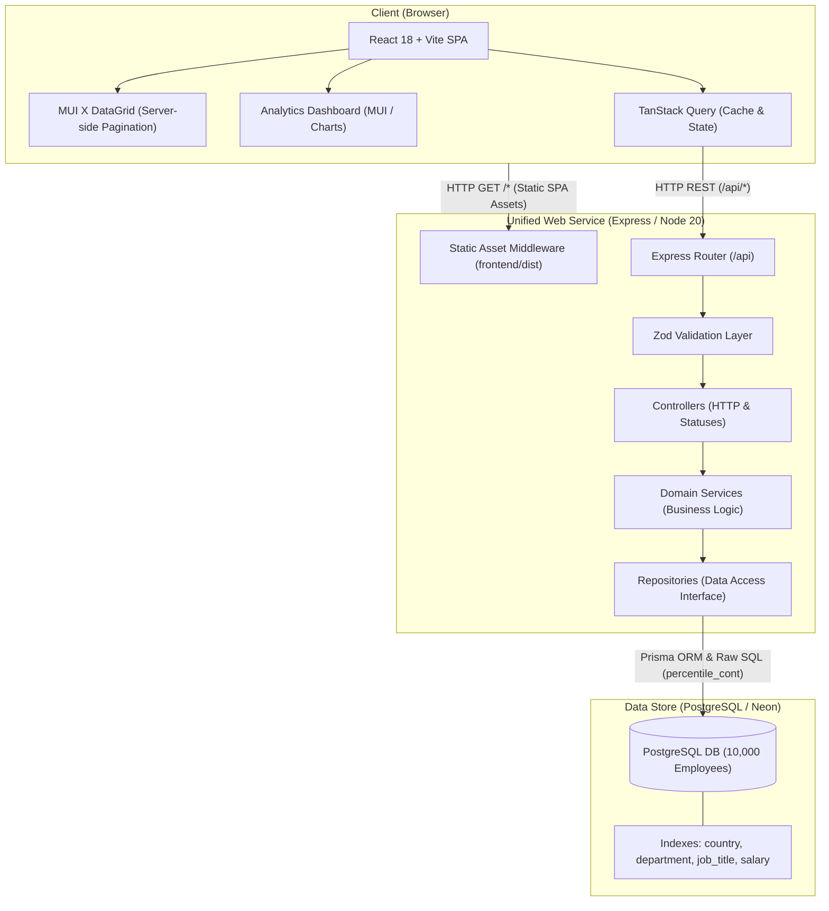

# System Architecture & Technical Design

## 1. Architecture Overview

The ACME Salary Management System is designed as a decoupled full-stack application that compiles into a single unified container deployment for production simplicity.



### Production Deployment Note
In production, Express serves the built frontend (`frontend/dist`) as static assets with an SPA wildcard fallback for non-`/api` routes. In development, Vite runs on port `5173` and proxies `/api` requests to Express on port `5000`. This completely eliminates CORS overhead and cookies/origin mismatches in production while preserving instant Hot Module Replacement during development.

---

## 2. Directory & Monorepo Structure

```text
salary-management/
├── backend/
│   ├── src/
│   │   ├── controllers/      # Express controllers (HTTP orchestration)
│   │   ├── db/               # Prisma client singleton
│   │   ├── middleware/       # Error handling, rate limiting, logging
│   │   ├── repositories/     # Database access (Prisma & raw SQL) + in-memory fakes
│   │   ├── routes/           # Express router endpoints
│   │   ├── schemas/          # Zod validation schemas
│   │   ├── seed/             # Deterministic 10k generator
│   │   ├── services/         # Pure domain logic
│   │   ├── utils/            # Math, formatting, errors
│   │   ├── app.ts            # Configured Express application (for Supertest)
│   │   └── server.ts         # Server entrypoint (listening on PORT)
│   ├── prisma/
│   │   ├── schema.prisma     # Prisma schema with mappings & indexes
│   │   └── seed.ts           # Batch database seeding script
│   └── tests/                # Unit, service, and Supertest integration tests
├── frontend/
│   ├── src/
│   │   ├── api/              # Typed fetch client & TanStack Query hooks
│   │   ├── components/       # Layout, Navigation, Alert, ConfirmationDialog
│   │   ├── features/
│   │   │   ├── employees/    # Employee DataGrid, Add/Edit modal, Delete flow
│   │   │   └── insights/     # Metrics cards, salary tables, distribution chart
│   │   ├── hooks/            # Custom reusable hooks (useDebounce, etc.)
│   │   ├── utils/            # Formatting (Intl.NumberFormat, currency)
│   │   ├── App.tsx           # Application root & Routing
│   │   └── main.tsx          # React DOM entry
│   └── tests/                # React Testing Library component & hook tests
└── docs/                     # Specifications, ADRs, Prompts, Performance
```

---

## 3. Data Model & Indexing Strategy

### Entity: `Employee`
Mapped to `employees` table in PostgreSQL with snake_case column names.

| Field | DB Column | Type | Constraints / Description |
|---|---|---|---|
| `id` | `id` | `UUID` | Primary Key, default `gen_random_uuid()` |
| `fullName` | `full_name` | `VARCHAR(120)` | Not Null |
| `email` | `email` | `VARCHAR(150)` | Not Null, Unique Index |
| `jobTitle` | `job_title` | `VARCHAR(100)` | Not Null |
| `department` | `department` | `VARCHAR(80)` | Not Null |
| `country` | `country` | `CHAR(2)` | Not Null, ISO 3166-1 alpha-2 code |
| `currency` | `currency` | `CHAR(3)` | Not Null, ISO 4217 code |
| `annualSalary` | `annual_salary` | `DECIMAL(12,2)` | Not Null, Check (`annual_salary > 0`) |
| `employmentType` | `employment_type`| `ENUM` | `FULL_TIME`, `PART_TIME`, `CONTRACT` |
| `hireDate` | `hire_date` | `DATE` | Not Null |
| `createdAt` | `created_at` | `TIMESTAMPTZ` | Default `now()` |
| `updatedAt` | `updated_at` | `TIMESTAMPTZ` | Auto-updated on modification |

### Index Justification
1. `idx_employees_email` (`email` UNIQUE): Fast lookup by email and enforcing uniqueness at DB level.
2. `idx_employees_country_currency` (`country`, `currency`): Essential for filtering by country and guaranteeing consistent currency groupings in aggregations.
3. `idx_employees_department_currency` (`department`, `currency`): Optimizes department salary analytics.
4. `idx_employees_job_title_currency` (`job_title`, `currency`): Optimizes job title aggregations and salary band lookups.
5. `idx_employees_annual_salary` (`annual_salary`): Speeds up sorting by salary, quartile calculation (`percentile_cont`), and range filtering.
6. `idx_employees_search` (`full_name`, `job_title`): Supports fast case-insensitive search filtering across employee records.

---

## 4. REST API Contract

All requests and responses use JSON.

### Standard Error Response Shape
```json
{
  "error": {
    "code": "VALIDATION_ERROR",
    "message": "Invalid input provided.",
    "details": [
      {
        "field": "annualSalary",
        "issue": "Annual salary must be greater than 0"
      }
    ]
  }
}
```

### Endpoints

#### 1. `GET /api/employees`
Paginated search & filter query.
- **Query Params**:
  - `page`: integer (default 1)
  - `pageSize`: integer (default 25, max 100)
  - `search`: string (case-insensitive match on name, email, job title)
  - `country`: string (optional, 2-letter code)
  - `department`: string (optional)
  - `sortBy`: `fullName` | `jobTitle` | `department` | `annualSalary` | `hireDate` (default `createdAt`)
  - `sortOrder`: `asc` | `desc` (default `desc`)
- **Response** (`200 OK`):
```json
{
  "data": [
    {
      "id": "c1f7b494-0a37-4d1a-8285-8025219f518e",
      "fullName": "Sarah Jenkins",
      "email": "sarah.jenkins@acme.org",
      "jobTitle": "Engineering Manager",
      "department": "Engineering",
      "country": "US",
      "currency": "USD",
      "annualSalary": 165000.00,
      "employmentType": "FULL_TIME",
      "hireDate": "2021-04-15",
      "createdAt": "2021-04-15T08:30:00.000Z",
      "updatedAt": "2024-01-10T12:00:00.000Z"
    }
  ],
  "meta": {
    "page": 1,
    "pageSize": 25,
    "totalCount": 10000,
    "totalPages": 400
  }
}
```

#### 2. `POST /api/employees`
Create employee record.
- **Request Body**:
```json
{
  "fullName": "Jane Doe",
  "email": "jane.doe@acme.org",
  "jobTitle": "Senior Software Engineer",
  "department": "Engineering",
  "country": "DE",
  "currency": "EUR",
  "annualSalary": 88000,
  "employmentType": "FULL_TIME",
  "hireDate": "2023-02-01"
}
```
- **Response**: `201 Created` with created employee entity.

#### 3. `GET /api/employees/:id`
Fetch single employee by UUID. Returns `200 OK` or `404 Not Found`.

#### 4. `PUT /api/employees/:id`
Update an employee record. Returns `200 OK` with updated record.

#### 5. `DELETE /api/employees/:id`
Delete an employee record. Returns `204 No Content`.

#### 6. `GET /api/meta/filters`
Returns distinct values for UI filter dropdowns.
- **Response** (`200 OK`):
```json
{
  "countries": [
    { "code": "US", "name": "United States", "currency": "USD" },
    { "code": "IN", "name": "India", "currency": "INR" }
  ],
  "departments": ["Engineering", "Product", "Sales", "HR", "Finance", "Legal"]
}
```

#### 7. `GET /api/insights/summary`
Organizational overview with currency separation.
- **Response** (`200 OK`):
```json
{
  "totalHeadcount": 10000,
  "countryCount": 8,
  "payrollByCurrency": [
    { "currency": "USD", "headcount": 2500, "totalPayroll": 312500000.00 },
    { "currency": "INR", "headcount": 2200, "totalPayroll": 4840000000.00 }
  ]
}
```

#### 8. `GET /api/insights/by-country`
Aggregated pay metrics grouped by country and currency.
- **Response** (`200 OK`):
```json
[
  {
    "country": "US",
    "currency": "USD",
    "headcount": 2500,
    "min": 45000.00,
    "p25": 85000.00,
    "median": 120000.00,
    "p75": 160000.00,
    "max": 280000.00,
    "avg": 125000.00
  }
]
```

#### 9. `GET /api/insights/by-department?country=US`
Aggregated pay metrics grouped by department. If `country` is supplied, filtered to that country's currency.
- **Response** (`200 OK`): List of aggregated objects containing `department`, `currency`, `headcount`, `min`, `p25`, `median`, `p75`, `max`, `avg`.

#### 10. `GET /api/insights/by-job-title?country=US`
Aggregated pay metrics grouped by job title.
- **Response** (`200 OK`): List of aggregated objects containing `jobTitle`, `currency`, `headcount`, `min`, `p25`, `median`, `p75`, `max`, `avg`.

#### 11. `GET /api/insights/distribution?country=US&bucketSize=25000`
Salary bucket distribution histogram data for a selected country.
- **Response** (`200 OK`):
```json
{
  "country": "US",
  "currency": "USD",
  "bucketSize": 25000,
  "buckets": [
    { "rangeStart": 50000, "rangeEnd": 75000, "count": 210 },
    { "rangeStart": 75000, "rangeEnd": 100000, "count": 520 },
    { "rangeStart": 100000, "rangeEnd": 125000, "count": 780 }
  ]
}
```

#### 12. `GET /api/insights/top-earners?country=US&limit=10`
Top earners across org or within a country.
- **Response** (`200 OK`): Array of top employee objects.

---

## 5. Architectural Trade-offs & Decisions

| Decision Area | Selected Approach | Alternatives Considered | Rationale |
|---|---|---|---|
| **Pagination** | Offset Pagination (`page`, `pageSize`) | Keyset (cursor) pagination | At 10,000 records, offset pagination with indexed columns executes in `< 15ms`. Offset pagination enables direct arbitrary page jumping in MUI DataGrid, whereas keyset requires previous cursor tokens. |
| **Statistical Percentiles** | PostgreSQL `percentile_cont(...)` via `$queryRaw` | Pulling all records into Node.js memory | Fetching 10,000 records into Node.js consumes memory and blocks the event loop. PostgreSQL calculates exact continuous percentiles in single-digit milliseconds using disk/RAM buffers. |
| **Currency Handling** | Strict grouping by currency; no FX conversion | Converting all currencies to USD via fixed or real-time rates | FX rates fluctuate daily and introduce false pay disparity perceptions. Aggregating currencies independently ensures mathematical and auditing truth. |
| **Deployment Model** | Unified Docker container (Express serves React static assets) | Split deployment (Vercel frontend + Render backend) | Unified container eliminates CORS issues, simplifies environment management, avoids cross-service cold starts, and provides a single URL for evaluation. |
| **Testing Strategy** | In-memory repository for services + Supertest for routes | Live PostgreSQL connection for all tests | In-memory fakes execute hundreds of tests in under 2 seconds hermetically without database setup/teardown friction. Live DB tests are isolated to repository integration tests. |

---

## 6. Performance Considerations for 10,000 Employees

1. **Query Latency**: With B-tree indexes on `(country, currency)`, `department`, `annual_salary`, and `email`, index scans replace table scans. Queries filter and sort 10k rows in `< 20ms`.
2. **Payload Size**: Server-side pagination caps page size at 100 (default 25), transferring `< 15KB` per request rather than a 3MB entire table dump.
3. **Database Aggregation**: `GROUP BY` with `percentile_cont` leverages Postgres parallel workers and native sorting routines.
4. **Serialization Safety**: PostgreSQL raw queries return `BigInt` for counts and `Decimal` for money. Repositories serialize these to standard JavaScript `number` objects before sending HTTP responses to prevent `JSON.stringify` serialization crashes.
